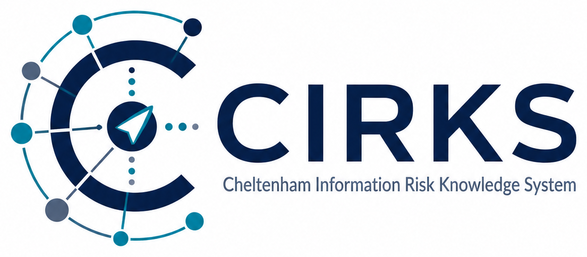

<!-- SPDX-License-Identifier: Apache-2.0 -->
<!-- Copyright (C) 2026 Wightman Brown Limited -->

<picture>
  <source media="(prefers-color-scheme: dark)" srcset="docs/images/brand/cirks-logo-dark.png">
  
</picture>

# CIRKS — Cheltenham Information Risk Knowledge System

**Information risk your board can trust: every score traced to the evidence
behind it.**

[](https://github.com/WightmanBrown/cirks/actions/workflows/ci.yml)
[](https://github.com/WightmanBrown/cirks/releases)
[](LICENSE)
[](https://wightmanbrown.github.io/cirks/)

**[Install](#install)** · **[Documentation](https://wightmanbrown.github.io/cirks/)** ·
**[Download](https://github.com/WightmanBrown/cirks/releases)** ·
**[Support](SUPPORT.md)** · **[Services](#support-and-services)**

Most risk registers are spreadsheets of opinions. Two assessors score the same
risk differently, the scores go stale as soon as something changes, and nobody
can say afterwards why a risk is a 12 and not an 8. These spreadsheets take time
and effort and often end up as shelf-ware.

CIRKS takes a different approach. It uses the same governance data to create
information risk knowledge held as a model of your organisation i.e. its
information, its systems, the threats you face and the controls actually in
place, then works the risk scores out from that model. When a
control fails, a system changes, or an information asset is re-rated, every
affected risk moves with it, and every score can show exactly where it came
from.

> **An example from the training data.** Misty Isles Government's VPN has no
> MFA for contractors, so the VPN is recorded as degraded. Every system that
> relies on remote access shows the higher risk at once, without anyone
> re-scoring it. Fix the VPN, and they all come down together.

| If you are | CIRKS gives you |
|---|---|
| **On the board** | One clear and consistent picture of information risk, where any rating can be traced to the facts behind it, and spending proposals that show the risk reduction they buy. Less uncertainty |
| **The CISO** | A register that stays consistent whoever assesses it, shows the common causes behind many risks, turns gaps into a worklist, and keeps actions, exceptions and Security Working Group decisions in one audited place. |
| **An information or system owner** | Plain questions about what you own i.e. how much does this information matter, is this control working, instead of being asked to score risks. |
| **An auditor** | A Statement of Applicability, frozen quarterly reviews, minutes that cannot change once issued, and an audit trail enforced by the database itself. |

CIRKS is open source (Apache 2.0) and runs on any Linux machine within Docker.
The [install guide](docs/INSTALL.md) builds a training instance, loaded with a
fictional organisation and a year of risk management already done, in well under
an hour.

**What CIRKS is not.** It is not a compliance checklist tool, and it does not put
risk in pounds. It ranks risks consistently, explains every one, and shows what
fixing something would change.

### For boards

CIRKS gives the board a single, consistent view of information risk in which every rating can be traced to its cause, and every investment shows the risk it removes. Accepted risks do not quietly disappear; each one records who accepted it and why, and it expires on a set date, so it comes back to be decided again. Boards ask specific questions about information risk, and CIRKS is built to answer them with evidence rather than reassurance. Therefore, as a board member you can ask:

- "Why is this red?" Every rating in CIRKS can be opened up to show where it came from. The impact comes from the information the system holds, rated by the person who owns that information. The likelihood comes from the controls actually working on that system. Therefore, a director who challenges a number gets the facts behind it, not a debate about whether someone scored it fairly.

- "Are we getting safer?" Each quarter's review is frozen once it closes, so this quarter can be compared with last quarter on the same basis. Because scores are worked out the same way every time, a change in the picture means something changed in the organisation, not that a different person did the scoring.

- "What will this money buy?" A proposed security action lists exactly what it will put in place, and CIRKS works out the risk it will leave behind. Investment decisions can be made on the risk reduction each option delivers, before the money is spent.

### For CISOs

CIRKS changes what you spend your time arguing about. A score cannot be negotiated directly, because it is worked out from facts. The conversation moves from "is this a 12 or an 8?" to "is MFA actually working on this system?", which is a question with an answer. Therefore, as the CISO:

- You stop being the scorer and become the keeper of the model. Business owners rate their own information, system owners record what is deployed, and risk owners validate their risks or send them back. The scores follow. Responsibility sits with the people who own the facts, which is where ISO 27001 puts it.
- You can see common causes. One weak shared service shows up on every system that depends on it, so the fixes with the most leverage stand out instead of hiding behind dozens of separate entries.
- Gaps become a worklist. CIRKS raises findings by itself, such as a control objective that applies but has nothing to deliver it, and each one needs a response, i.e. either act or accept until a date. Exceptions expire on schedule, and separation of duties can stop risk owners accepting their own.
- Your evidence holds up. Validation, ownership changes and the audit trail are enforced in the database, not only in the application, so the record stands even if someone works around the interface. And minutes cannot be edited once issued.
- Your SOC gets business context. An analyst can look up an IP address or hostname from an alert and see the systems behind it, with their impact and current risk.
- You can be clear about the cost. The numbers mean something only once assets are rated and controls recorded system by system, and they stay current only if people keep control statuses honest. As a suggestion, start with one department and use the Misty Isles training instance to learn the model before loading your own.

### For department heads
Department heads i.e. information asset owners, system owners and risk owners, are usually handed a risk spreadsheet once a quarter and asked to rate information risks using unfamiliar language. CIRKS asks them something easier and more useful, to say what the impact is in business terms. Therefore, as a business owner:
- You answer questions about what you own, in plain language. How much harm would it do if this information leaked, was altered or became unavailable? Is this control working on your system? Those are questions you can answer better than anyone, and expert detail is one click away if you want it.
- Your answers count everywhere they apply. Rate an information asset once, and every system that holds it and every risk on those systems takes its impact from your rating. You do not have to keep dozens of scores in step by hand.
- You see the effect of your decisions. When a fix is completed on your system, the risk it addressed comes down, and you can see by how much. When you accept a risk, the record shows it was your call, and it comes back for review on a set date.
- You can disagree, formally. If a risk on your system looks wrong, you can return it with your reasons rather than signing it off.
- You see what is yours. Access follows your department, so you work on your own information and systems without wading through everyone else's.


## Install

CIRKS runs on any Linux machine with Docker: the application, a PostgreSQL 17
database and a Caddy web server serving it over HTTPS. The full, step-by-step
guide is **[docs/INSTALL.md](docs/INSTALL.md)**. It builds one of two things:

| | You get | Use it to |
|---|---|---|
| **A training instance** | *Misty Isles Government*, a fictional organisation with a year of risk management already done — 52 systems, 228 risks, actions, exceptions, minuted meetings | learn CIRKS, demonstrate it, try things out. Never put real information in it. |
| **Your organisation's instance** | an empty CIRKS with its reference data (roles and permissions, the NIST CSF 2.0 control objectives, impact descriptors) | record your own organisation, loaded from a spreadsheet workbook |

In outline, on Ubuntu with Docker installed (the guide explains every step and
what to check after it):

```bash
git clone https://github.com/WightmanBrown/cirks.git ~/cirks && cd ~/cirks
cp .env.docker.example .env      # then generate the secrets and choose a host name: guide Part 2
docker compose up -d --build
```

Then either

```bash
# A — training instance (about six minutes; asks for the administrator's password)
docker compose exec app node riskapp/db/dataset/misty-isles/install.js
```

or

```bash
# B — your organisation: first administrator, then load the capture workbook
docker compose exec app node riskapp/db/create-admin.js --email you@example.org --name "Your Name"
docker compose exec app node riskapp/db/import.js /import --password '<starting password>'
```

The workbook for B is [docs/templates/CIRKS-organisation-capture.xlsx](docs/templates/CIRKS-organisation-capture.xlsx).
Running CIRKS day to day — upgrades, backups, TLS options, air-gapped installs —
is in [docs/deployment.md](docs/deployment.md).

## What it does

The core idea is that risk should be derived from things you already record:

- **Impact** comes from your information assets. You rate each asset against
  your impact tables; a system's impact is the highest of the assets it holds,
  and every risk on that system follows.
- **Probability** comes from the controls that counter each threat. For each
  control you judge how likely an attack is to succeed with it in place; a
  risk's probability is the best judgement among the controls actually working
  on that system, never worse than the threat's own likelihood.
- **Controls follow their security solutions.** A control objective is met on a
  system when the security solution that delivers it is in place and working
  there.
- **Remediation is built from the gap.** A security action lists the
  components that are missing or not working. Completing them brings the
  objective into place and lowers the risk. **Target risk** is derived from the
  actions you have committed to.


Everything else hangs off that spine: risk validation, exceptions with expiry
dates, assurance findings, suppliers and their evidence, the Statement of
Applicability, and the Security Working Group's meeting cycle.


## Documentation

The documentation site is **[wightmanbrown.github.io/cirks](https://wightmanbrown.github.io/cirks/)**:

- [Installing CIRKS](docs/INSTALL.md): a training instance, or your
  organisation's, from an empty Ubuntu machine. Its Part 4 covers maintenance,
  backups and restoring onto a wiped machine.
- [Running CIRKS](docs/deployment.md): upgrades, TLS options, air-gapped
  installs.
- [The organisation capture workbook](docs/templates/README.md): loading your
  organisation.
- [The modelling sequence](docs/modelling-sequence.md),
  [modelling patterns](docs/modelling-patterns.md) and
  [terminology](docs/terminology.md): how to model an organisation well.

## Releases

Download a release from the
**[releases page](https://github.com/WightmanBrown/cirks/releases)**, or clone a
release tag. What changed in each version is in the [changelog](CHANGELOG.md).
For anything you care about, install a tagged release rather than the latest
code on `main`, and rehearse each upgrade on a copy of your data.

## Support and services

- **Questions and ideas:** [Discussions](https://github.com/WightmanBrown/cirks/discussions).
- **Bugs:** [Issues](https://github.com/WightmanBrown/cirks/issues/new/choose).
- **Implementation, training, support agreements and virtual CISO services**
  from Wightman Brown Limited, the creators of CIRKS:
  <cirks@wightmanbrown.ltd.uk>.

See [SUPPORT.md](SUPPORT.md) for details.

## How CIRKS protects what it holds

- **Auth:** 15-minute access tokens + 30-day refresh tokens. Reusing a consumed
  refresh token revokes the whole token family.
- **RBAC:** roles map to **capabilities** (`capabilities` + `role_permissions`),
  administered in-app. Route guards check a capability, not a role name.
- **Scoping:** three orthogonal axes — role decides *what you can do*, department
  decides *which rows you can read*, and seat (current role + department) decides
  *which rows you can write*. A person changing department is re-gated
  automatically.
- **Separation of duties:** identity-based database triggers, per-rule and
  org-configurable (default off) — e.g. an exception may not be accepted by the
  risk owner.
- **Audit:** `audit_log` records governance decisions — risk validation and
  return, role switches, Statement of Applicability changes — and, via database
  triggers, every change of owner, manager or department on a system,
  information asset or business service, attributed to the person who made it.
  Because those are triggers rather than application code, a change made outside
  the application is recorded too. `api_request_log` separately records every API
  call with its caller, route, status and timing. Both are readable in-app by
  admins.
- **Machine access:** SOC integrations authenticate with an API key
  (`X-API-Key`) scoped to a `soc_analyst` role holding only `knowledge.query`.

Risk validation and return run as PostgreSQL stored functions, and
accountability changes are audited by database triggers — both chosen so the
rule holds regardless of caller, including a migration, a repair script or a
session in `psql`.

To report a vulnerability, see [SECURITY.md](SECURITY.md).

## Contributing

Contributions are welcome. [CONTRIBUTING.md](CONTRIBUTING.md) explains how to
set up a development environment, run the tests, and sign off your commits.
Everyone taking part follows the [code of conduct](CODE_OF_CONDUCT.md).

## Licence and trademarks

Copyright © 2026 Wightman Brown Limited. Open source under the
[Apache License 2.0](LICENSE). See [NOTICE](NOTICE) for copyright, trademark and
third-party attributions.

"CIRKS", "Cheltenham Information Risk Knowledge System" and the CIRKS logo are
trademarks of **Wightman Brown Limited**. The licence grants rights in the software, not in the
name: see the [trademark policy](TRADEMARKS.md) for how you may use it.
