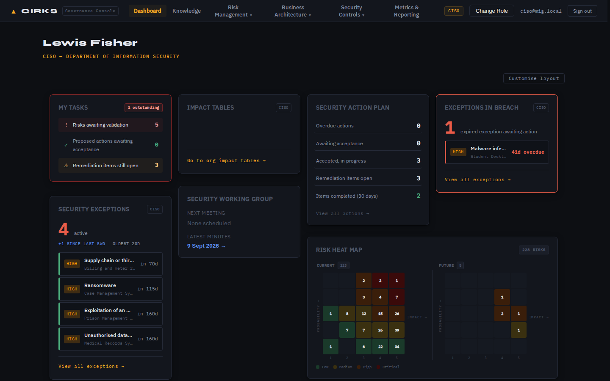
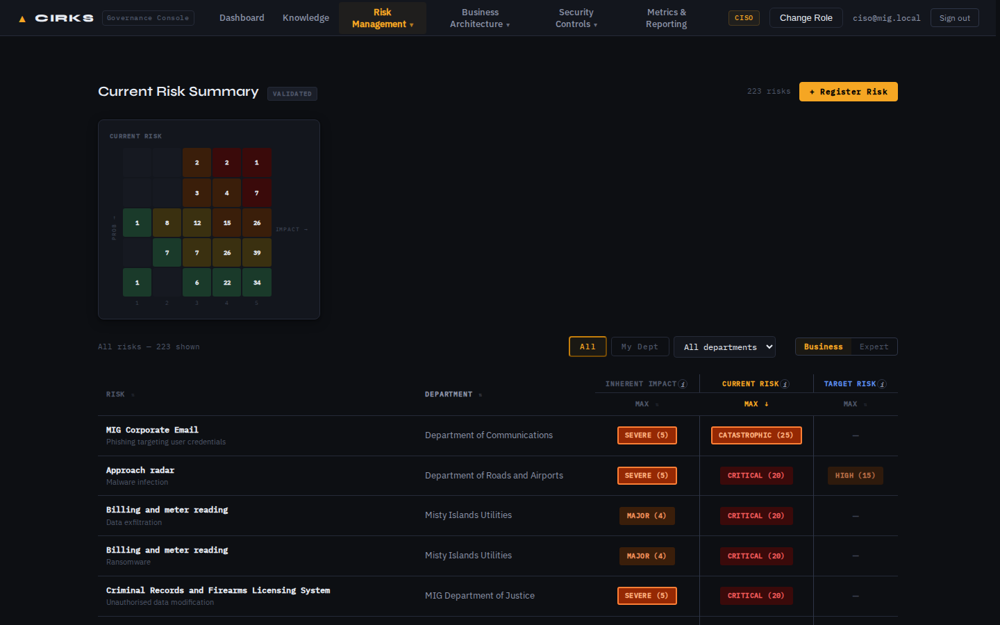
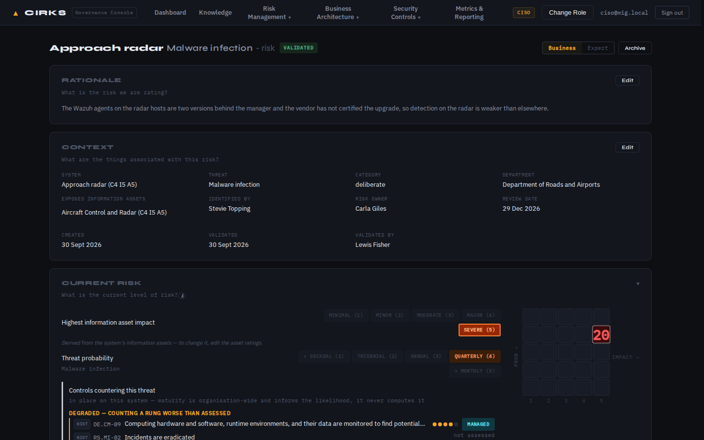

<!-- SPDX-License-Identifier: Apache-2.0 -->
<!-- Copyright (C) 2026 Wightman Brown Limited -->

# CIRKS — Cheltenham Information Risk Knowledge System

**Information risk your board can trust: every score traced to the evidence
behind it.**

[](https://github.com/WightmanBrown/cirks/actions/workflows/ci.yml)
[](https://github.com/WightmanBrown/cirks/releases)
[](LICENSE)
[](https://wightmanbrown.github.io/cirks/)

**[Install](#install)** · **[Documentation](https://wightmanbrown.github.io/cirks/)** ·
**[Download](https://github.com/WightmanBrown/cirks/releases)** ·
**[Support](SUPPORT.md)** · **[Services](#support-and-services)**

CIRKS is an open-source information risk management platform, aligned with
ISO/IEC 27001, for CISOs, risk analysts and the boards they report to. It
replaces the risk spreadsheet with a model of your organisation: its
information, systems, threats and controls. Risk is **derived** from that model,
so it is consistent, explainable, and changes when the evidence changes. It is
never typed in as opinion.



## Install

CIRKS runs on any Linux machine with Docker: the application, a PostgreSQL 17
database and a Caddy web server serving it over HTTPS. The full, step-by-step
guide is **[docs/INSTALL.md](docs/INSTALL.md)**. It builds one of two things:

| | You get | Use it to |
|---|---|---|
| **A training instance** | *Misty Isles Government*, a fictional organisation with a year of risk management already done — 52 systems, 228 risks, actions, exceptions, minuted meetings | learn CIRKS, demonstrate it, try things out. Never put real information in it. |
| **Your organisation's instance** | an empty CIRKS with its reference data (roles and permissions, the NIST CSF 2.0 control objectives, impact descriptors) | record your own organisation, loaded from a spreadsheet workbook |

In outline, on Ubuntu with Docker installed (the guide explains every step and
what to check after it):

```bash
git clone https://github.com/WightmanBrown/cirks.git ~/cirks && cd ~/cirks
cp .env.docker.example .env      # then generate the secrets and choose a host name: guide Part 2
docker compose up -d --build
```

Then either

```bash
# A — training instance (about six minutes; asks for the administrator's password)
docker compose exec app node riskapp/db/dataset/misty-isles/install.js
```

or

```bash
# B — your organisation: first administrator, then load the capture workbook
docker compose exec app node riskapp/db/create-admin.js --email you@example.org --name "Your Name"
docker compose exec app node riskapp/db/import.js /import --password '<starting password>'
```

The workbook for B is [docs/templates/CIRKS-organisation-capture.xlsx](docs/templates/CIRKS-organisation-capture.xlsx).
Running CIRKS day to day — upgrades, backups, TLS options, air-gapped installs —
is in [docs/deployment.md](docs/deployment.md).

## Why CIRKS

- **For the board:** one consistent picture of information risk, where every
  rating can be traced back to the facts it came from. Less doubt, fewer
  surprises.
- **For the CISO:** a register that stays current as systems, controls and
  information change, with validation, security actions, exceptions and
  Security Working Group meetings in one place, and an audit trail.
- **For risk analysts and asset owners:** clear questions to answer, in plain
  language, with expert detail one click away.
- **For auditors:** a Statement of Applicability, approved and frozen versions,
  and minutes that cannot be changed once issued.

## What it does

The core idea is that risk should be derived from things you already record:

- **Impact** comes from your information assets. You rate each asset against
  your impact tables; a system's impact is the highest of the assets it holds,
  and every risk on that system follows.
- **Probability** comes from the controls that counter each threat. For each
  control you judge how likely an attack is to succeed with it in place; a
  risk's probability is the best judgement among the controls actually working
  on that system, never worse than the threat's own likelihood.
- **Controls follow their security solutions.** A control objective is met on a
  system when the security solution that delivers it is in place and working
  there.
- **Remediation is built from the gap.** A security action lists the
  components that are missing or not working. Completing them brings the
  objective into place and lowers the risk. **Target risk** is derived from the
  actions you have committed to.



Everything else hangs off that spine: risk validation, exceptions with expiry
dates, assurance findings, suppliers and their evidence, the Statement of
Applicability, and the Security Working Group's meeting cycle.



## Documentation

The documentation site is **[wightmanbrown.github.io/cirks](https://wightmanbrown.github.io/cirks/)**:

- [Installing CIRKS](docs/INSTALL.md): a training instance, or your
  organisation's, from an empty Ubuntu machine. Its Part 4 covers maintenance,
  backups and restoring onto a wiped machine.
- [Running CIRKS](docs/deployment.md): upgrades, TLS options, air-gapped
  installs.
- [The organisation capture workbook](docs/templates/README.md): loading your
  organisation.
- [The modelling sequence](docs/modelling-sequence.md),
  [modelling patterns](docs/modelling-patterns.md) and
  [terminology](docs/terminology.md): how to model an organisation well.

## Releases

Download a release from the
**[releases page](https://github.com/WightmanBrown/cirks/releases)**, or clone a
release tag. What changed in each version is in the [changelog](CHANGELOG.md).
For anything you care about, install a tagged release rather than the latest
code on `main`, and rehearse each upgrade on a copy of your data.

## Support and services

- **Questions and ideas:** [Discussions](https://github.com/WightmanBrown/cirks/discussions).
- **Bugs:** [Issues](https://github.com/WightmanBrown/cirks/issues/new/choose).
- **Implementation, training, support agreements and virtual CISO services**
  from Wightman Brown Limited, the creators of CIRKS:
  <cirks@wightmanbrown.ltd.uk>.

See [SUPPORT.md](SUPPORT.md) for details.

## How CIRKS protects what it holds

- **Auth:** 15-minute access tokens + 30-day refresh tokens. Reusing a consumed
  refresh token revokes the whole token family.
- **RBAC:** roles map to **capabilities** (`capabilities` + `role_permissions`),
  administered in-app. Route guards check a capability, not a role name.
- **Scoping:** three orthogonal axes — role decides *what you can do*, department
  decides *which rows you can read*, and seat (current role + department) decides
  *which rows you can write*. A person changing department is re-gated
  automatically.
- **Separation of duties:** identity-based database triggers, per-rule and
  org-configurable (default off) — e.g. an exception may not be accepted by the
  risk owner.
- **Audit:** `audit_log` records governance decisions — risk validation and
  return, role switches, Statement of Applicability changes — and, via database
  triggers, every change of owner, manager or department on a system,
  information asset or business service, attributed to the person who made it.
  Because those are triggers rather than application code, a change made outside
  the application is recorded too. `api_request_log` separately records every API
  call with its caller, route, status and timing. Both are readable in-app by
  admins.
- **Machine access:** SOC integrations authenticate with an API key
  (`X-API-Key`) scoped to a `soc_analyst` role holding only `knowledge.query`.

Risk validation and return run as PostgreSQL stored functions, and
accountability changes are audited by database triggers — both chosen so the
rule holds regardless of caller, including a migration, a repair script or a
session in `psql`.

To report a vulnerability, see [SECURITY.md](SECURITY.md).

## Contributing

Contributions are welcome. [CONTRIBUTING.md](CONTRIBUTING.md) explains how to
set up a development environment, run the tests, and sign off your commits.
Everyone taking part follows the [code of conduct](CODE_OF_CONDUCT.md).

## Licence and trademarks

Copyright © 2026 Wightman Brown Limited. Open source under the
[Apache License 2.0](LICENSE). See [NOTICE](NOTICE) for copyright, trademark and
third-party attributions.

"CIRKS" and "Cheltenham Information Risk Knowledge System" are trademarks of
**Wightman Brown Limited**. The licence grants rights in the software, not in the
name: see the [trademark policy](TRADEMARKS.md) for how you may use it.
