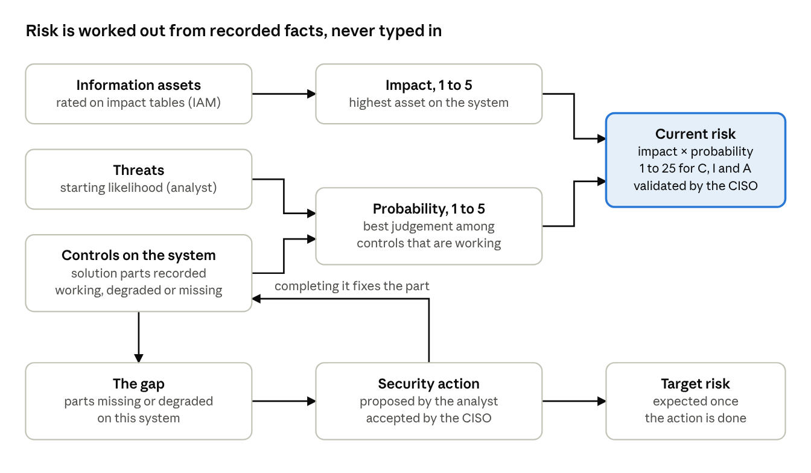
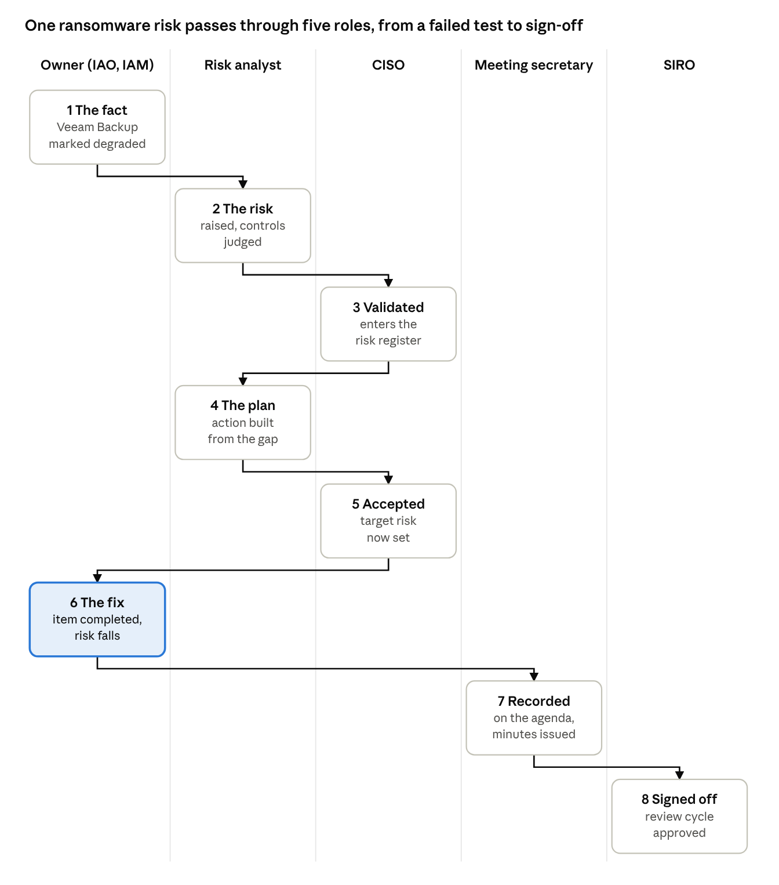

# CIRKS walkthrough: Misty Isles for first-time users

Version 1.0, 23 October 2026

**Contents**

1. [Start here: the one idea behind CIRKS](#start-here-the-one-idea-behind-cirks)
2. [Setting up so you can see every viewpoint](#setting-up-so-you-can-see-every-viewpoint)
3. [The Misty Isles cast](#the-misty-isles-cast)
4. [Finding your way around](#finding-your-way-around)
5. [Viewpoint walkthroughs](#viewpoint-walkthroughs)
6. [Follow one risk from end to end](#follow-one-risk-from-end-to-end)
7. [Exercises, and the problems hidden in the story](#exercises-and-the-problems-hidden-in-the-story)
8. [Glossary and rough edges](#glossary-and-rough-edges)

## Start here: the one idea behind CIRKS

CIRKS works out risk for you from facts you record, so most of your time goes on describing the organisation, not on typing in risk scores. Once that idea clicks, the screens make much more sense.

This guide assumes you have a training instance with the Misty Isles Government (MIG) loaded, as set up in the install guide. It walks you through the system as each kind of user sees it, because CIRKS shows each role a different set of jobs. Read sections 1 to 4 once, then dip into the role walkthroughs in section 5 in any order.

### How a risk gets its score

In CIRKS a risk is always about one threat, acting on one system, putting one information asset in danger. It is scored separately for confidentiality, integrity and availability (often shortened to C, I and A).

**Impact** (1 to 5) comes from the information assets. Someone who owns an asset, such as a payroll dataset, rates how bad it would be if it leaked, was corrupted or became unavailable, using the organisation's impact tables. A system's impact is the highest rating of any asset it holds. You never type impact onto a risk.

**Probability** (1 to 5) comes from the controls. Each threat has a starting likelihood. For each control that counters it, someone judges how likely the attack is to succeed with that control in place. The risk takes the best judgement among the controls that are actually working on that system, and is never worse than the threat's own likelihood.

**Risk score** is impact times probability, so 1 to 25, worked out for C, I and A and then combined into one summary score. Misty Isles sets a mandatory-action score of 12; anything at or above it must have a plan to reduce it and cannot be waved through as "no action required".

### Where controls come from

Controls are not ticked on and off by hand. A **security solution** is a defined bundle of parts (technology, people and process) that delivers one or more **control objectives**. When all its parts are in place and working on a system, the objective counts as met there. If a part is missing or degraded, the objective is not met and probability goes up.

### How risk comes down

The gap between what a solution needs and what is there becomes a **security action**, a list of the missing or broken parts. Committing to an action gives you a **target risk**, the score you expect once it is done. Completing it brings the objective into place and lowers the current risk automatically.



*Figure 1. How a risk score is built: facts, scores and the action loop*

Read it left to right. People record facts in the left column and CIRKS works out the middle and right. The bottom row is how risk comes down; completing an action fixes a part, which feeds back into the controls.

Three scores appear everywhere. **Inherent impact** is the worst-case harm before any controls. **Current risk** is where you stand today. **Target risk** is where you will be once the committed actions are complete.

## Setting up so you can see every viewpoint

After the Misty Isles install only the administrator can sign in, so unlock about five more accounts and you can see every working role. The installer deliberately gives every other account a random password nobody knows; the accounts still exist and still own their risks and systems, they just cannot sign in until you set a password.

### Take a snapshot first

Before you change anything, take a VMware snapshot of the CIRKS VM and name it something like "Misty Isles clean". The exercises in this guide change the data (approving risks, completing actions, closing meetings), and some changes are one-way. A snapshot lets you roll back in seconds instead of rebuilding. Take a second one after you have unlocked the accounts below.

### The accounts worth unlocking

Several Misty Isles people hold more than one role, which saves you unlocking lots of accounts.

| Account | Person | Roles held | Why unlock it |
|---|---|---|---|
| A.James@mig.local | Alfredo James | Administrator | Already unlocked; accounts, setup and help text |
| ciso@mig.local | Lewis Fisher | CISO, risk analyst, security consultant | Three viewpoints in one account; start here |
| siro@mig.local | Helen Wright | SIRO | The senior owner who signs off review cycles and accepts exceptions |
| B.Kirk@mig.local | Bob Kirk | Information asset owner and information asset manager, Justice | Justice holds the Windows 7 prison system exception and a half-finished security tool migration |
| swg.secretary@mig.local | Morag Sinclair | Meeting secretary | Plans, runs and minutes the Security Working Group |
| S.Topping@mig.local | Stevie Topping | Administrator, risk analyst, SOC analyst | Optional; a second analyst, and the SOC analyst view |
| B.Liskov@mig.local | Barbara Liskov | Information asset manager, Justice | Optional; the same department as Bob, seen by the person who only keeps the records |

### Unlocking them through the screens

1. Sign in as A.James@mig.local with the password you chose at install.
2. Open **Admin**, then **Account Management**.
3. Find the person's row and choose **Reset password**, type a training password of at least 12 characters, then **Set**.
4. Repeat for each account in the table. Using one shared training password for all of them is fine on a training box.
5. Choose **Sign out** (top right) and sign in as the next person.

### Or all at once from the VM's terminal

The password reset tool accepts the new password from the environment, so a short loop does every account in one go. Replace the example password with your own.

```bash
cd ~/cirks
for e in ciso@mig.local siro@mig.local B.Kirk@mig.local swg.secretary@mig.local S.Topping@mig.local B.Liskov@mig.local; do
  docker compose exec -T -e NEW_PASSWORD='Training-Pass-2026' app node riskapp/db/reset-password.js --email "$e"
done
```

### Switching role inside one account

When someone holds several roles, CIRKS signs them in to their main role and shows it in the header. A **Change Role** button appears beside it; choose it and pick another role to see that role's dashboard and menus. The data does not change, only the jobs offered and what you are allowed to do.

### Seeing two people side by side

A browser can only be signed in as one person to cirks.local at a time, because the sign-in is held in the browser's storage for that site, shared by all its tabs. To watch a hand-over between two people (say the asset owner submits something and the CISO receives it), open a private window for the second person. Private windows keep their own storage, separate from your normal window.

### Roles nobody holds in Misty Isles

The security architect role exists in CIRKS but no Misty Isles person has it. If you want to see it, change a spare account's role (Vint Cerf, for example) on Account Management, reset its password and sign in. The SOC analyst role has no dashboard yet; its value is read-only access to risks, systems and the knowledge search.

## The Misty Isles cast

Misty Isles is a small island government with 12 departments, 31 people and 52 systems, built so that ten or so realistic problems produce a believable risk picture. Knowing who is who, and where the problems sit, tells you what you are supposed to find.

### The roles in one line each

| Role | What the person is for | Can change |
|---|---|---|
| Administrator | Runs the CIRKS installation itself | Accounts, access rules, help text, data export, and almost all records |
| CISO | Runs the security programme and is the gatekeeper for the risk register | Validates or returns new risks, accepts security actions and exceptions, acts on findings |
| Risk analyst | Builds and maintains the model | Threats, controls, systems, components and risks; judges how well each control works |
| SIRO (senior information risk owner) | The board-level owner of information risk | Approves each quarterly review cycle, accepts or revokes exceptions, publishes impact tables |
| Information asset owner (IAO) | Accountable for one department's information and its risks | Mostly reads; completes actions assigned to the department, responds to findings, maintains supplier records |
| Information asset manager (IAM) | Keeps one department's records up to date | That department's assets and their ratings, systems, services, impact tables and suppliers |
| Meeting secretary | Runs the Security Working Group (SWG) paperwork | Plans meetings, builds agendas, records decisions, issues minutes |
| Security consultant | Onboards an organisation during the setup phase | Systems, assets, services and threats; moves CIRKS from setup to operational |
| Security architect | Defines the standard security building blocks | Architecture patterns and components |
| SOC analyst | Security operations staff who need to look things up | Nothing; read-only |

Two things are worth noticing. Only the CISO can validate a risk, so everything the analyst raises queues up for the CISO. And IAMs and IAOs only see their own department; everyone else sees the whole organisation.

### The departments

The accountable owner is the person recorded against the department; risks on its systems are theirs.

| Department | Accountable owner | Records kept by | Systems | Worth knowing |
|---|---|---|---|---|
| Communications | Gordon Welchman | Vint Cerf | 12 | The shared IT estate, such as email, identity, backup, desktops and network. Email runs on Exchange 2019, out of support since October 2025 |
| Information Security | Stevie Topping | Katie Sommer, Radia Perlman | 7 | The security services everyone else relies on (endpoint detection, monitoring, intrusion detection, VPN). The VPN does not enforce MFA for contractors |
| Roads and Airports | Carla Giles | Katherine Johnson | 6 | Approach radar's monitoring agents are two versions behind. The driver licensing system is deliberately left half-recorded |
| Utilities | Edwina Lectric | Michael Faraday | 5 | Water Distribution's last backup restore test failed. The billing supplier's assurance report has expired |
| Justice | Bob Kirk | Barbara Liskov | 4 | Prison Management runs Windows 7, accepted by exception. Criminal Records is mid-way through swapping security tools |
| Health | Katie Sommer | Florence Nightingale | 4 | Medical Records carries one of the most serious risks |
| Education | Jack Finx | Seymour Papert | 3 | Pupil records carries one of the most serious risks. Student desktops are only partly covered by endpoint protection |
| Treasury | Mia Karloff | Charles Babbage | 3 | A banking portal supplied by a third party |
| Cabinet Office | Helen Wright (also the SIRO) | Jean Bartik | 3 | The HR system's supplier contract has no exit terms. Hosts the Electoral Roll in Azure |
| DEFA (Environment, Fisheries and Agriculture) | Ada Lovelace | Rosalind Franklin | 2 | Field teams use satellite links and VPN back to base |
| Maritime | Alan Turing | William Thomson | 2 | Coastal radar is recorded as both a Windows server and an OT device, which creates a deliberate conflict |
| Disaster and Emergency Management | Margret Hamilton | Hedy Lamarr | 1 | Emergency communications over secure radio |

Most accountable owners also hold the IAM role, so they can edit their own records too.

### The central security team

Lewis Fisher is the CISO (ciso@mig.local), and also holds the risk analyst and security consultant roles. Stevie Topping is the other risk analyst and an administrator. Morag Sinclair is the SWG secretary. Katie Sommer is a security consultant and stands in as a second secretary. Helen Wright is the SIRO. Alfredo James, the administrator, sits in Communications.

### What the history gives you

The installer replays a year of work through the real screens as these people. You get 228 risks, 77 of them at or above the mandatory-action score of 12, a backlog of new risks awaiting the CISO, 5 security actions (some overdue), 5 exceptions (one lapsed into breach), and four quarterly review cycles. Three cycles are closed and signed off; the current one is open, with its next SWG meeting already planned.

## Finding your way around

Every screen has the same header, and menus only appear when your role can use something in them, so two people looking at the same page can see quite different menus. If a menu would hold just one item it shows as a plain link instead.

### The header

On the right you see your current role in capitals, a **Change Role** button if you hold more than one role, and **Sign out**. Administrators also get an **Edit help** toggle, which lets them write the text behind the small ⓘ help markers (more on that in section 8).

### The menus

| Menu | What lives there | Who sees it |
|---|---|---|
| Dashboard | Your role's home page of widgets | Everyone |
| Knowledge | A search across the whole model ("which systems use Exchange?") | Everyone except the SIRO and meeting secretary |
| Risk Management | **Current Risks** (the validated register), **New Risks** (raised but not yet validated), **Pending Review** (CISO only), Threats, Security Actions, Security Exceptions, Assurance Findings, Impact Tables, and the meetings pages (All Meetings, Plan Meeting, Acceptance Queue) | Most roles, each seeing only the items they can use |
| Business Architecture | Organisation (departments), Business Services, Information Assets, Systems, Suppliers, and the building blocks of systems (People and Groups, Processes, Technology Components, Facilities) | Everyone except the meeting secretary and SIRO, who see very little here |
| Security Controls | Control Library, Statement of Applicability, Scopes, Policies and documents, Remediation roll-up, and the security architecture pages (Security solutions, Systems architecture template, Security pattern triggers, System architecture patterns) | Everyone who can read controls |
| Setup | Objectives and standards (loading control frameworks) | Administrator |
| Admin | Account Management, Access Control, Data Export, Audit Log, API Keys, Help Content | Administrator |
| SIRO | Review Cycles | SIRO |
| Metrics & Reporting | A placeholder page; reporting is marked "coming soon" | Everyone |

### The dashboard widgets

Every dashboard starts with **My Tasks**, the most useful widget in CIRKS: it counts the things waiting for you and each line is a link straight to the work. A red count is something you must do; amber is for awareness. The other widgets differ by role.

| Role | Widgets after My Tasks |
|---|---|
| CISO | Impact Tables, Security Action Plan, exceptions in breach, Security Exceptions, Security Working Group, Risk Heat Map |
| Risk analyst | Probability signals, Security Action Plan, Security Exceptions, Security Working Group, Risk Heat Map, Control Effectiveness |
| SIRO | Cycle Approval, Security Actions, Impact Tables, exceptions in contravention of policy, Security Exceptions, Security Working Group |
| IAO and IAM | My Risks, My Information Assets, My Business Services, Systems in my remit, Security Exceptions, Security Working Group |
| Meeting secretary | SWG Meetings, Agenda Prep, Action Progress |
| Security consultant | Onboarding Handover, Control Set (marked "coming soon"), Security Working Group |
| Security architect | Systems, Security Working Group |
| Administrator | System Setup, User Management, Security Working Group |

The Security Working Group widget appears for almost everyone. It shows the next meeting and the latest minutes, and offers a calendar invite and a personalised meeting pack.

### Three habits that help

Click through rather than hunt through menus. Risks link to their system, asset and threat; systems link to their risks; widgets link to the list behind each number. Second, when a list looks short, check whether a filter is applied; the risk lists open filtered when you arrive from a system. Third, read the coloured chips and banners on a record before anything else, because CIRKS uses them to say what is unfinished or wrong.

## Viewpoint walkthroughs

Work through the roles in this order, because it follows the flow of real work. The analyst raises, the CISO decides, owners and managers act, the secretary records, and the SIRO signs off. Each walkthrough says who to sign in as, what to look at first, and a few things to try. Steps marked *changes data* are safe on a training box but worth a snapshot first.

### The CISO

**Sign in as** Lewis Fisher, ciso@mig.local. He lands in his CISO role.

**Look first at My Tasks.** It shows the risks awaiting validation (the backlog the installer left for you), proposed security actions awaiting acceptance (three were deliberately left in the queue), and open action items across the organisation. Then look at the Risk Heat Map, which plots every risk by impact and probability; click a cell to list the risks in it. The exceptions-in-breach widget shows one lapsed exception, on the Student Desktop malware risk.

**Things to try.**

1. Open **Risk Management, Current Risks** and sort by score. Open the top risk (expect MIG Corporate Email near the top) and read its Rationale, its Context, and the panel showing how impact and probability were derived. This is the page you will spend most time on.
2. Open **Pending Review**, pick a risk, read the analyst's rationale and choose to validate it. *Changes data.* Return a second one with a short note, to see the "returned" path; it goes back to the analyst's My Tasks.
3. Open **Acceptance Queue**. Each proposed action explains in plain English what accepting it would commit the organisation to. Accept one. *Changes data.* Accepting fixes the action's list of items and sets the baseline that target risk is measured from.
4. From the exceptions-in-breach widget, open the Student Desktop risk and look at the exception panel, with its **Renew** and **Revoke** buttons. Decide what you would do, but leave it for the SIRO exercise.

**What to notice.** The CISO is the gate. Nothing the analyst raises counts in the register until the CISO validates it, and no plan to fix anything is committed until the CISO accepts it.

### The risk analyst

**Sign in as** Lewis Fisher and choose **Change Role, Risk Analyst**, or sign in as Stevie Topping.

**Look first at** the probability signals widget, which lists risks where something changed on a system (a control went missing, say) and the probability may need judging again. Control Effectiveness shows which controls are doing the most work.

**Things to try.**

1. Open **Risk Management, New Risks**. This is the unvalidated list, the analyst's side of the CISO's Pending Review. Note the **Register Risk** button; a new risk needs only a system, a threat and a written rationale.
2. Open any risk and find the controls panel. It lists every control objective that counters the threat, whether it is in place on this system, and the probability someone judged with it in place. A heading reminds you that the best deployed control sets the score. Change a judgement and watch the score move. *Changes data.*
3. On a high risk with no action yet, build a security action from the coverage gap. CIRKS lists the parts that are missing or degraded and proposes them as items. *Changes data.* The new action lands in the CISO's Acceptance Queue.
4. If you returned a risk as the CISO, it now appears in My Tasks as returned. Open it, read the Return Notes, edit the rationale and choose **Resubmit for validation**.
5. Try **Knowledge** in the menu bar. Search for "Exchange" or "Windows 7" to see every system, risk and component that mentions it.

**What to notice.** The analyst never types an impact score. Their judgement goes into one place only, i.e. how well each control works against each threat.

### The information asset owner (IAO)

**Sign in as** Bob Kirk, B.Kirk@mig.local, owner of Justice. He lands in his IAO role.

**Look first at** My Risks, a heat map and top-risks list for Justice only, then My Information Assets, My Business Services and Systems in my remit. The Security Exceptions widget shows the Prison Management exception.

**Things to try.**

1. From Systems in my remit, open **Prison Management System**. Look at its components, grouped as people, process, technology and facility, and at its control objectives. Endpoint protection is recorded as not applicable because no agent runs on Windows 7.
2. Open the Prison risk (exploitation of an unpatched vulnerability) and read the exception. It is a formal, time-limited acceptance, with a written justification (the 2027 replacement and network isolation), an expiry about six months out and quarterly reviews.
3. Open **Criminal Records and Firearms Licensing System**. The OSSEC agent is shown degraded with its reason, because it is being retired while CrowdStrike takes over.
4. Open the Criminal Records asset and see its confidentiality, integrity and availability ratings. They were raised to Severe, and that is why every risk on the system has a high impact.
5. From the Security Working Group widget, open your personalised meeting pack for the next meeting.
6. If an accepted action on one of Bob's systems has open items, a **Complete…** button appears for him. CIRKS lets the owner of a system complete work on it, as well as the CISO and analysts.

**What to notice.** Bob sees Justice and nothing else. As an IAO he can look but changes little; the editing happens in his other role.

### The information asset manager (IAM)

**Sign in as** Bob Kirk and choose **Change Role, Information Asset Manager**, or sign in as Barbara Liskov.

**Things to try.**

1. Open an information asset (the Criminal cases asset, say) and change one rating up a level. *Changes data.* Then open the system that holds it and its risks; the impact, and every risk score built on it, moves straight away. This is the one-way chain from section 1 in action.
2. Open a system and add or change a component, then look at its control objectives. Whether an objective is met follows from the parts recorded, not from a tick box.
3. Look at **Suppliers** for Justice and the evidence held against each one, with its dates.

**What to notice.** The IAM records facts; CIRKS recalculates. If a score looks wrong, the fix is almost always a fact upstream of it.

### The meeting secretary

**Sign in as** Morag Sinclair, swg.secretary@mig.local.

**Look first at** SWG Meetings (meetings needing agenda prep, and meetings waiting for minutes), Agenda Prep and Action Progress (security actions whose owners need to send an update).

**Things to try.** This is the best end-to-end exercise in the dataset, so take a snapshot first.

1. Open **All Meetings**. You will see three past meetings with issued minutes, a recent one, and the next one already planned and linked to the current review cycle.
2. Open the planned meeting. Its agenda is generated from the live state of the register (new risks, actions, exceptions and findings), so it is never written by hand. Check the attendees.
3. Run the meeting. Items that need a formal decision are marked "Decision required"; record one against each. *Changes data.*
4. Close the meeting, recording whether it was quorate, then write the minutes and choose **Issue minutes**. *Changes data, one-way.*

**What to notice.** Issuing the minutes seals the meeting and moves the current review cycle to "under review". That is the hand-over to the SIRO, which is the next walkthrough.

### The SIRO

**Sign in as** Helen Wright, siro@mig.local.

**Look first at** Cycle Approval, the exceptions-in-contravention widget (the lapsed Student Desktop exception, framed for oversight rather than action), Security Actions and Impact Tables.

**Things to try.**

1. Open **SIRO, Review Cycles**. The three past cycles are approved. If you issued minutes as the secretary, the current cycle is now waiting for approval. Open its summary of risks, actions and decisions, then approve it. *Changes data, one-way.*
2. Open the lapsed Student Desktop exception and decide whether to **Renew** it (with a new expiry) or **Revoke** it, which sends the risk back to needing treatment. *Changes data.*
3. Look at the Acceptance Queue; the SIRO can accept actions too.
4. Open **Impact Tables** to see what each impact level means for Misty Isles. Organisation-wide tables cover harms such as life and safety, public finances and public confidence, and some departments add their own (Justice has one for policing, custody and evidential integrity).

**What to notice.** The SIRO sees summaries and decisions, not the model. There is no Knowledge search and very little of Business Architecture. That is by design; a SIRO's job is oversight.

### The security consultant

**Sign in as** Lewis Fisher and choose **Change Role, Security Consultant**.

**Look first at** the Onboarding Handover widget. During setup, a consultant builds the organisation's picture; when the CISO and SIRO both accept the handover, CIRKS moves permanently from its setup phase to operational and the consultant loses some powers.

**Things to try.**

1. Open **Risk Management, Business Departments** to see the department setup wizard, the way a new organisation is entered by hand.
2. Open **Business Architecture, Systems** and start creating a system to see the questions the wizard asks, then cancel.

**What to notice.** Do not complete the handover unless you have a snapshot; it cannot be undone. This role matters when you load a real organisation, much less for day-to-day use.

### The administrator

**Sign in as** Alfredo James, A.James@mig.local.

**Look first at** System Setup, which checks the prerequisites are configured, and User Management.

**Things to try.**

1. Open **Admin, Audit Log** and filter by user or role (type "ciso", say). Every step the installer took as each persona is there with a plain-English narrative. This is the quickest way to see what a year of CIRKS work looks like.
2. Open **Admin, Access Control**. It shows each person's primary and additional roles, the permissions each role holds, department isolation and separation-of-duties rules. Read it, but change it only on a snapshot.
3. Open **Admin, Help Content** to see the help markers that exist, and try writing one (see section 8).

**What to notice.** The administrator can see almost everything but takes no part in risk decisions; validation and review cycles belong to the CISO and SIRO.

## Follow one risk from end to end

The clearest way to see how the roles fit together is to follow a single risk, ransomware on Water Distribution in Utilities, from the fact that causes it to the board sign-off. You need the CISO, risk analyst, secretary and SIRO accounts, and a snapshot to roll back to afterwards.



*Figure 2. The ransomware risk’s journey: eight steps across five roles*

Each column is a role and each box is one step of the walk below. The risk only falls at step 6, when a fact about a part changes.

### The story behind it

Water Distribution's backups are taken by Veeam, but the last quarterly restore test of the control system's historian failed. Someone recorded the Veeam Backup part on that system as degraded, with that reason. A degraded part means the backup control objective is not met there, so backups earn no reduction against ransomware. The system holds one information asset, Water control signalling, rated at the top level (5) on several impact tables including drinking water, life and safety, and public finances, so the impact is as high as it goes.

### The walk

1. **The fact (IAM).** As the CISO, open **Business Architecture, Systems, Water Distribution** and find Veeam Backup among its technology components, marked degraded with the restore-test reason. In real life the Utilities IAM would record this.
2. **The impact (IAO and IAM).** Open the system's information assets and their ratings. The system's impact is the highest of them.
3. **The risk (analyst).** Open the system's risks and choose the ransomware risk. Read the rationale; it was written by the analyst and names the failed restore test. In the controls panel, notice that the backup objective is not counting because its delivering part is degraded.
4. **The decision (CISO).** The risk is in Current Risks, so the CISO has already validated it. Look at its treatment decision and its Security actions section.
5. **The plan (analyst, then CISO).** If there is no action yet, switch to the risk analyst role and build one from the coverage gap; its item will be to bring Veeam Backup back to operational on this system. Switch back to CISO and accept it in the Acceptance Queue. The risk now shows a **target risk**, lower than the current one. *Changes data.*
6. **The fix (system owner or CISO).** Pretend the restore test has been rerun successfully. On the risk page, choose **Complete…** on the item. *Changes data.* Veeam Backup becomes operational on the system, the backup objective is met, the probability falls, and the current risk drops to meet the target. Check the Risk history panel, which records the change and why.
7. **The record (secretary).** Sign in as Morag Sinclair and look at the planned SWG meeting's agenda. The agenda is built from the register, with sections for new risks, action progress, exceptions and assurance. Its agenda was generated when the meeting was planned, so choose Generate agenda to refresh it and see your change appear.
8. **The sign-off (SIRO).** Once the secretary issues the minutes, sign in as Helen Wright and approve the review cycle that now contains this change.

### What to take from it

Nobody typed a risk score at any point. The score moved because a fact about a part on a system changed, and every role saw the consequence in its own terms, i.e. a component for the IAM, a probability for the analyst, an action for the CISO, an agenda line for the secretary and a cycle summary for the SIRO.

## Exercises, and the problems hidden in the story

The Misty Isles risk picture comes from a short list of deliberate problems, each sitting on a named part with a written reason. Finding them yourself is the best test that you can navigate CIRKS; try each one before reading the "where to look" column.

| Problem | Where to look | What you should see |
|---|---|---|
| Email server out of support | System MIG Corporate Email (Communications) | Exchange 2019 degraded, out of support since October 2025; several high risks including phishing and unpatched vulnerabilities |
| Prison system on Windows 7 | System Prison Management System (Justice) | No endpoint agent possible; the unpatched-vulnerability risk accepted by a time-limited exception until the 2027 replacement |
| Radar monitoring agents out of date | System Approach radar (Roads and Airports) | Wazuh agent degraded, two versions behind; the malware risk raised |
| Failed backup restore test | System Water Distribution (Utilities) | Veeam Backup degraded; the ransomware risk (section 6) |
| VPN without MFA for contractors | System MIG Remote Access VPN (Information Security), or search Knowledge for "GlobalProtect" | One degraded gateway shows up on every system that relies on remote access, all at once |
| Lab PCs only partly protected | System Student Desktop (Education) | Falcon agent degraded; the malware risk, and its exception that lapsed into breach |
| Security tool migration half done | System Criminal Records and Firearms Licensing (Justice) | OSSEC agent degraded while CrowdStrike takes over; the unauthorised-modification risk |
| Supplier assurance expired | Suppliers, Super Bill (Utilities' billing) | Its SOC 2 report has passed its expiry date, so the assurance reads as expired |
| Supplier contract with no exit terms | Suppliers, PeopleFirst HR (Cabinet Office) | Assurance only partial |
| Records left unfinished | Assurance Findings; System Driver and Vehicle Licensing System | Some assets not rated against every mandatory impact table; a system with its operating system, hosting, support team and user group left blank |
| A system that is two things at once | System Costal Radar and Ship Tracking (Maritime) | Recorded as both a Windows server and an OT device, so two security stacks apply and conflict |

### Test yourself

1. As the CISO, find the five highest risks and, for each, name the single fact that would lower it most. Check your answer against each risk's controls panel.
2. As Bob Kirk in his IAO role, explain to an imaginary auditor why the Prison Management risk is acceptable, using only what CIRKS shows you.
3. As the analyst, use Knowledge to find every system that would be affected if the CrowdStrike console failed.
4. As the SIRO, decide whether to renew or revoke the lapsed Student Desktop exception, and write the reason you would give.
5. As the IAM for Justice, lower one asset rating by a level, predict what will happen to its system's risks, then check. Roll back the snapshot afterwards.
6. As the administrator, use the Audit Log to reconstruct what happened to one security action from proposal to completion.

## Glossary and rough edges

CIRKS uses its words strictly, and much of the early confusion comes from reading them in their everyday sense. Keep this table open while you work.

### Glossary in plain English

| Term | What it means in CIRKS |
|---|---|
| Information asset | Business information you must protect, such as Criminal Records or patient records. Owned by an IAO and rated against impact tables |
| Impact table | A scale saying what each impact level (1 to 5) means for one kind of harm, such as life and safety or public finances. Some are mandatory for every asset |
| System | Something that holds or processes information assets. Its impact is the highest rating among its assets |
| Business service | What a department does for people, linked to the systems it relies on |
| Component | A building block of a system, of four kinds, i.e. people, process, technology and facility. Policies and documents are components too |
| Threat | Something that could go wrong, with a starting likelihood |
| Control objective | A job to be done, from the control library (NIST CSF 2.0 by default), such as "administrative access requires multi-factor authentication" |
| Control | How the organisation actually does that job, i.e. the components that together meet the objective |
| Standard requirement | A clause of an external standard (ISO 27001, PCI and so on), mapped onto control objectives. Only matters if you report against a standard |
| Security solution | A reusable bundle of parts that delivers one or more objectives, such as CrowdStrike EDR or Veeam backup |
| Implied, called for, recorded, delivered | An objective is implied when a system's parts trigger a solution that delivers it, called for when a threat on the system needs it, recorded when the system has a row for it, and delivered when a solution is settled for it |
| Inherent impact | The worst-case harm before any controls |
| Current risk | Today's risk, with the controls actually working |
| Target risk | The risk you expect once accepted actions are complete |
| Mandatory-action score | The score (12 in Misty Isles) at or above which a risk must have a plan to reduce it |
| Validation | The CISO's check on a newly raised risk. A risk is pending, returned (sent back with notes) or validated |
| Security action | A plan to close a gap, made of items (parts to fix or deploy). Proposed, then accepted, then completed item by item |
| Exception | A formal, time-limited acceptance of a risk, with a justification and review cadence. If it passes its date without renewal it lapses into breach. Who may accept one depends on how high the risk scores |
| Assurance finding | Something wrong with the management system that no risk explains, such as an asset not rated against a mandatory table |
| Statement of Applicability (SoA) | Which control objectives you have adopted and why, in ISO 27001 terms |
| Scope | A named set of systems where an objective applies, such as a payment card environment. By default an adopted objective applies to every system |
| Probability signal | A prompt to the analyst that something changed on a system and a risk's probability may need judging again |
| SWG and review cycle | The Security Working Group meets each quarter; each quarter is a review cycle, closed when the minutes are issued and approved by the SIRO |
| Setup and operational | CIRKS starts in a setup phase for onboarding, and moves to operational once the CISO and SIRO accept the handover. One way only |

### Rough edges to expect

These are things that may trip you up; several are worth raising as issues on the CIRKS repository.

1. **Help text is a first draft.** Every page title, panel title and table column carries an ⓘ marker with draft text (since CIRKS v1.0.5). As administrator you can switch on **Edit help** and rewrite any of it in your own organisation's words; clearing your text brings the draft back. Doing that as you learn doubles as good training notes.
2. **No "change my password" screen.** Passwords are set by the administrator on Account Management, or from the terminal.
3. **Some pages are placeholders.** Metrics & Reporting says "coming soon", the security consultant's Control Set widget is marked coming soon, and the SOC analyst has no dashboard.
4. **Review cycles cannot yet be created in the screens.** The installer creates them directly. Once you have approved the current cycle as the SIRO there is no next cycle to link a new meeting to, which is another reason to work from a snapshot.
5. **Some actions are one-way.** Issuing minutes, approving a cycle and completing the onboarding handover cannot be undone in the screens.
6. **Department ownership has a quirk in the data.** Health's recorded owner, Katie Sommer, sits in Information Security, and access follows a person's own department, so she appears to see Information Security's records rather than Health's. Grace Hopper, Health's other IAO, is the better account for a Health view.
7. **Words are still settling.** The menu says "New Risks" for the page titled "New Risk Summary", and the database still stores an objective and its control as one record, so a few screens blur the two. The terminology document in the CIRKS repository explains the intended meanings.

### Where to read more

The CIRKS repository's own documents go deeper on modelling, including [the modelling sequence](../modelling-sequence.md), [modelling patterns](../modelling-patterns.md), [terminology](../terminology.md) and [the Misty Isles story](misty-isles-architecture.md). This guide was written from the repository's source code, data and documents as of 23 October 2026, not from a running instance, so a label or two on screen may differ slightly.

