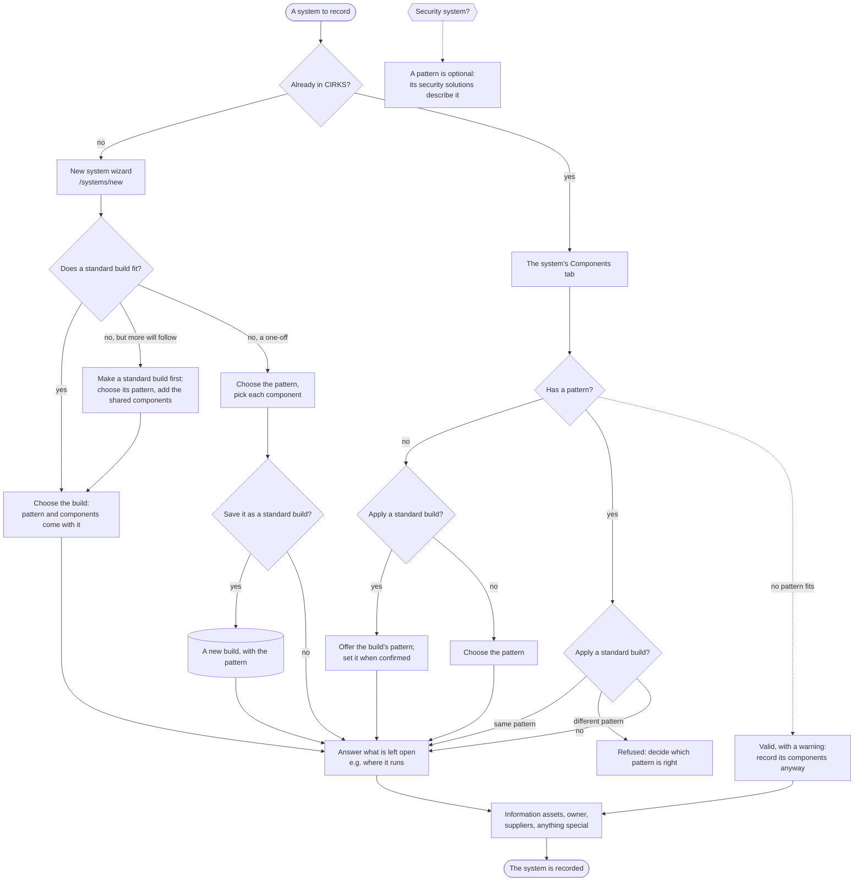

<!-- SPDX-License-Identifier: Apache-2.0 -->
<!-- Copyright (C) 2026 Wightman Brown Limited -->

# Modelling a department: the sequence

*Companion to `business-service-model.md`. Written
2026-08-19, against schema 0104.*

An IAM or IAO opening CIRKS for the first time faces four entity types that all
refer to each other, and no obvious end to pull first. This note says which end
to pull, why, and — more usefully — which parts do **not** have to wait for each
other.

## The short answer

**Interview top-down. Enter bottom-up.**

A department talks fluently about its *services* and vaguely about its
*information assets*, because services are what the business names. But a
service is the most **derived** thing in the model and the least enterable: you
cannot say anything true about one until its systems exist and their assets are
rated. So gather "what do you do?" first, and build in the opposite order.

## What the system actually enforces

Almost nothing. Every entity needs only a **name and a department**:

| Entity | Required to create |
|---|---|
| Information asset | name, department (`routes/assets/index.js:101`) |
| System | name, department (`routes/systems/index.js:128`) |
| Business service | name (`routes/services/index.js:219`) |
| Risk | system, threat, rationale (`routes/risks/index.js:956-959`) |

There is no enforced order, no required parent, and no wizard that must be
completed. You can create a service with no systems, a system with no assets, or
an asset rated against nothing — all three are legitimate intermediate states
and the UI shows them as unfinished rather than invalid.

So the sequence below is **not** a set of preconditions. It is the order in
which the numbers start meaning something.

## The one-way chain

Only one direction of derivation exists in the whole model, and everything hangs
off it:

```
impact table  (the scale — what a BIL level MEANS to this organisation)
   └─ asset rating                    ← the only number a human enters
        └─ asset C/I/A
             ├─ system impact         = MAX over the assets in that system
             │     └─ risk score      = impact × probability
             └─ service impact        = MAX over YOUR department's assets
                                         in the service's systems
```

Nothing upstream of a rating is computed. Nothing downstream of one is entered
by hand. That single fact is what makes the rest decouple: **inventory is
free-order, arithmetic is fixed-order.**

Two consequences worth stating plainly:

- **Every impact figure in the app appears at one moment** — when assets are
  rated. Before that, systems and services legitimately read as unrated (NULL,
  meaning "no rated assets"), not as zero.
- **You cannot raise a service's impact by editing the service.** There is no
  field. If the number looks wrong, the answer is upstream: which assets, in
  which systems, rated how.

## The circularity, and why most of it is gone

The genuine loop used to be **asset ↔ service**: an asset's suggested CIA came
from the services it belonged to, while a service's impact was derived from its
assets. v104 broke it. Services no longer link assets at all, and the
impact-table suggestion on an asset now comes from *assets sharing a system*
rather than sharing a service (`routes/assets/index.js:353`) — the same answer
with the loop removed.

What remains only looks circular:

| Apparent loop | Actually |
|---|---|
| system ↔ asset | One-way. Placing the asset **is** the act; the system's impact follows automatically. |
| service ↔ system | One-way. The service needs its systems to exist first; nothing flows back. |
| risk ↔ control | Genuinely mutual — probability is MIN over deployed controls, and the gap that proposes controls comes from the risk. Decoupled by v100: **identifying** a threat against a system is a first-class act that does not require assessing it. |
| impact table ↔ knowing what to write in it | Decoupled by unpublish. Nothing gates rating on a table being published, and a published table's levels can be edited after unpublishing. |

## The four passes

Passes, not a waterfall. Each is independently useful, and more than one person
can be working at a time.

### Pass 1 — Inventory. No numbers.

1. **Information assets.** Name and owner only. This is the only thing a
   department genuinely owns, and the only place a rating will ever be entered.
2. **Systems.** The things that hold the information. Place each asset into the
   systems it lives in — an asset in three systems is normal, not a modelling
   error.
3. **Business services.** Compose each from the systems that deliver it.

Nothing computes during this pass, which means nothing can be wrong yet. It also
parallelises: different people can name assets, systems and services at once.

### Pass 2 — The scale. Everything lights up.

4. **Confirm which impact tables apply** — the mandatory organisation-wide ones,
   plus any the department owns. (`mandatory` is advisory in the API: it marks a
   table as expected, it does not refuse a rating without one.)
5. **Rate the assets.** Asset C/I/A, system impact and service impact all appear
   at this moment, for every entity at once, without anyone visiting them.

This is the one step with a real prerequisite: a scale must exist before a
rating means anything. It is also the step that most repays care — see the
failure modes below.

### Pass 3 — Exposure.

6. **Identify threats** against systems. This needs only Pass 1: a threat can be
   recorded against a system before anything is rated.
7. **Assess** the ones that matter, producing risks.

Deliberately separated, because "we know this applies and haven't scored it yet"
is an honest and common state. Identified-but-unassessed is visible on the
systems list rather than hidden.

### Pass 4 — Treatment.

8. **Controls** deployed on systems; the coverage gap becomes security actions;
   completing an action's items lowers the risk incrementally.

## Building a system: start from a standard build

**Needed in the user manual and in training** (owner, 2026-11-18; design in
`system-patterns.md`, decisions 16–23, proposed and not built yet).

We model a system only to answer security questions, so a system's record is its
**pattern** (which questions it must answer) plus the **components** that answer
them. A standard build is a pattern partly answered in advance. The usual path:

1. **Choose the standard build.** The system takes the build's pattern and its
   components (copied, so a later change to the build changes nothing here).
2. **Answer what the build left open.** A build leaves out what differs between
   systems, most often *where it runs*. The system's Components tab lists the
   unanswered questions.
3. **Add the rest of the system**: its information assets, owner, suppliers and
   anything special about it.

With no build that fits, build it by hand: choose the pattern, answer its
questions, and save it as a standard build if more systems like it will follow.

### The entry points

There is more than one way in, so this draft flow chart is for the manual. It
shows the PROPOSED flow: builds do not carry a pattern yet.



Other ways in, not drawn: a bulk import (`db/import.js`) states each system's
pattern in the data, and a security system can be left with no pattern.

## Infrastructure and shared systems

Networks, identity services and shared platforms need their own rule, because
the instinct — attach every asset that crosses them — puts the risk on
departments that cannot act on it. See **Pattern: Infrastructure systems** in
[`modelling-patterns.md`](modelling-patterns.md): an infrastructure system holds
the asset that *is* its function, owned by the department that operates it, and
the test for when the rule stops applying is *"if this were breached, whose data
is exposed?"* versus *"if it stopped, whose service stops?"*.

That pattern and this sequence are the same piece of work in the demo dataset:
detaching infrastructure assets makes service → system dependency links the only
route by which a department sees a shared system's risk.

## Two failure modes to warn people about

Both are now visible in the UI, but only if you know to look.

**Over-linking systems to a service.** Link what *delivers* the service, not
everything it transitively depends on. MIGNet is a dependency of Corporate
Email, not of Government Communications directly. Get this wrong across the
register and every service inherits the busiest shared system, which is exactly
the flattening the department-filtered derivation exists to prevent. The
picker's grouping is the guard: candidates appear under **"systems holding your
information"** or **"systems you would depend on — you hold nothing here"**, and
the second group is a deliberate choice, not a default.

**Rating everything 5.** A rating records *your department's* stake, not the
system's worst case. That is precisely what lets Education read BIL 2 inside a
shared system where Justice and Health read 5. A department that rates
everything at the top loses the ability to say which of its own information
matters most — and the roll-up stops telling leadership anything.

A third, smaller one: **"n/a" is not a way to skip a dimension.** Statement
presence is the applicability switch, so writing "n/a" into a level makes that
dimension count. Leave it blank instead.

## Where this bites the demo dataset

As of 2026-08-19 the CIRKS-test dataset has **96 active services, 10 with any
system linked**. Everything above Pass 1 step 3 is therefore empty for most of
the register: no derived assets, no service impact, no risk roll-up. Re-linking
services to their systems is the outstanding work, and this sequence is the
order to do it in.
